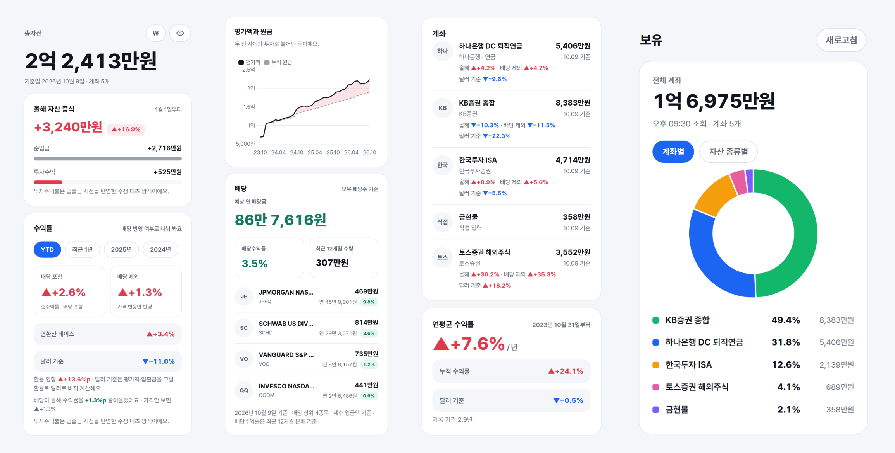

# 개미장부 (gaemi)

여러 증권 계좌와 퇴직연금, 예금·금까지 한 장부에 모아 **총자산이 얼마나, 왜 불었는지** 보여 주는 개인용 자산 앱입니다. 한국투자증권·토스증권 Open API로 매일 알아서 갱신되고, 폰에서는 홈 화면 앱처럼 열립니다. 서버 비용은 0원이고, 장부와 API 키는 내 기기에만 있습니다.



<sub>화면은 모두 데모 데이터입니다.</sub>

> **English summary.** 개미장부 ("ant's ledger"; Korean retail investors call themselves *gaemi*, ants) is a self-hosted portfolio tracker for Korean brokerage accounts. It pulls balances from the KIS (Korea Investment & Securities) and Toss Securities Open APIs, infers deposits and withdrawals from daily cash changes, computes money-weighted returns (Modified Dietz) with and without dividends and in USD terms, simulates early retirement on dividend income (FIRE) under Korean taxes and health insurance, and serves a mobile web app. One command starts it in Docker and opens a setup page that checks each broker connection live; a second sets up an optional Cloudflare Worker (free plan) that gives your phone a read copy behind Cloudflare Access. Your ledger and API keys stay on your own machine. MIT licensed.

## 시작하기

필요한 것은 [Docker](https://docs.docker.com/get-docker/)(Engine 28 이상)와 증권사 Open API 키뿐입니다. 윈도우는 WSL 터미널에서 실행하세요.

```bash
git clone https://github.com/HyeonguDO/gaemi.git && cd gaemi
./gaemi
```

브라우저가 http://localhost:8000 을 열고 **연결 설정** 화면을 보여 줍니다.

1. 맨 위에 **이 기기의 공인 IP**가 나옵니다. 토스증권처럼 허용 IP를 쓰는 곳에 등록할 주소입니다.
2. 증권사 키를 넣고 **저장하고 연결 확인**을 누르면 그 자리에서 실제로 조회해 봅니다. 성공하면 총자산을, 실패하면 이유와 해결 방법을 보여 줍니다(예: "이 서버의 IP가 토스에 등록돼 있지 않아요 → 허용 IP 관리에 등록하세요").
   - **한국투자증권**: [KIS Developers](https://apiportal.koreainvestment.com)에서 신청. 계좌번호 앞 8자리와 상품코드(위탁 `01`)도 넣습니다. 1년마다 연장해야 하고, 토큰 발급 때 오는 카카오톡 알림은 정상입니다.
   - **토스증권**: 토스증권 PC 웹(WTS)의 `설정 > Open API`에서 발급하고, 위 공인 IP를 허용 IP로 등록합니다.
3. `입력` 탭에서 각 계좌의 지난해 말 평가액을 넣으면 올해 수익률이 나옵니다(잔고증명서에서 확인).

그다음부터는 손댈 게 없습니다. 같은 컨테이너가 매일 23:50에 증권사를 동기화하고, 꺼져 있던 동안 놓친 동기화는 다시 켜질 때 바로 합니다. 키는 `data/.env`(권한 600)에만 저장되고 화면에 다시 보여 주지 않습니다.

| 명령 | 하는 일 |
|---|---|
| `./gaemi` | 시작(이미 돌고 있으면 새 코드로 다시 시작)하고 브라우저 열기 |
| `./gaemi phone` | 폰에서 보기 설정 (아래) |
| `./gaemi setup` | 화면 대신 터미널 질문으로 키 넣기 (같은 연결 확인과 실패 이유) |
| `./gaemi update` | 새 버전 받아서 다시 시작 |
| `./gaemi logs` / `./gaemi down` | 기록 보기 / 멈추기 |

AI 코딩 도구(Claude Code, Codex, Cursor 등)를 쓰신다면 이 폴더에서 **"개미장부 셋업해 줘"** 라고 해도 됩니다. 키는 채팅에 붙여 넣지 말고 설정 화면에 직접 넣으세요.

## 폰에서 보기

PC에서 15분마다 화면 데이터를 Cloudflare Worker(무료 플랜)에 올리고, 폰은 그 주소를 Cloudflare 계정 로그인으로 엽니다. 폰에서 넣은 값은 PC가 켜질 때 반영되고, PC가 꺼져 있어도 마지막 데이터는 볼 수 있습니다.

```bash
./gaemi phone
```

1. 토큰 만들기 화면이 **필요한 권한이 미리 채워진 채로** 열립니다. `요약 계속`, `토큰 생성`을 누르고 토큰을 복사해 붙여 넣습니다(입력해도 화면에 안 보임, 저장하지 않음).
2. Worker 이름과 폰에서 로그인할 이메일을 물은 뒤, 무엇을 만들지 보여 주고 확인을 받습니다.
3. 데이터베이스, 로그인 보호(Cloudflare Access), PC용 열쇠, 배포를 차례로 만들고, 실제로 접속해 확인한 뒤 키를 `data/.env`에 저장합니다. 앱은 다시 시작할 필요 없이 15분 안에 첫 데이터를 올립니다.
4. 폰에서 출력된 주소를 열고 Cloudflare 계정으로 로그인한 뒤 `홈 화면에 추가`. 로그인은 30일 유지됩니다.

알아 둘 점:
- Cloudflare 계정에서 **Zero Trust를 한 번 켜야** 합니다([one.dash.cloudflare.com](https://one.dash.cloudflare.com)에서 팀 이름을 정하고 Free 플랜). 카드 등록을 요구할 수 있지만 청구되지 않습니다. 안 켜져 있으면 스크립트가 알려 줍니다. workers.dev 주소가 아직 없는 새 계정이면 스크립트가 이름을 물어 만들어 줍니다.
- 같은 이름의 Worker나 데이터베이스가 있으면 덮어쓰지 않고 멈춥니다. 다른 Worker, DNS, 로그인 방법은 건드리지 않습니다. 중간에 실패하면 이유(예: "API 토큰에 'D1 / Edit' 권한이 있는지 확인하세요")를 보여 주고, 만든 것은 `./gaemi phone --remove`로 지웁니다.
- 끝나면 토큰은 Cloudflare 대시보드에서 지워도 됩니다.
- **베타**: 권한이 채워진 토큰 링크와 오류 안내는 실제 계정에서 확인했지만, Access 앱 생성부터 마지막 연결 확인까지는 실제 계정에서 끝까지 돌려 보지 않았습니다(공식 API 문서와 가짜 서버로 검사). 문제가 있으면 이슈로 알려 주세요. 손으로 하는 방법은 [`cloud/wrangler.toml.example`](cloud/wrangler.toml.example) 맨 위에 있습니다.

## 무엇을 보여 주나

- **총자산과 올해 자산 증식**: 늘어난 돈을 내가 넣은 돈(순입금)과 투자로 번 돈(투자수익)으로 나눠 보여 줍니다.
- **수익률 세 가지**: 기간(YTD, 최근 1년, 연도별)마다 **배당 포함**, **배당 제외**, **달러 기준**(환율 변동 제외) 수익률. 입출금 시점을 반영하는 수정 디츠(Modified Dietz) 방식입니다.
- **배당**: 보유한 배당주만으로 계산한 배당수익률, 예상 연 배당금, 종목별 배당률, 월별 배당금.
- **보유 종목**: 지금 잔고, 종목별 평가액과 손익(원화, 달러 기준), 계좌별 또는 자산 종류별(주식·채권·금·코인·현금) 원그래프.
- **입출금 자동 추정**: 한투·토스는 입출금 내역 API가 없어서, 매일의 현금 변화에서 매매대금과 배당을 빼서 추정합니다.
- **FIRE 시뮬레이션**: 원하는 나이부터 배당만으로(또는 자산을 나눠 써서) 세후 월 얼마를 받을 수 있는지, 모자라면 매달 얼마를 어디에 더 넣어야 하는지. 한국 세금과 지역가입자 건강보험료를 반영하고, 종목별 막대를 끌면 바로 다시 계산합니다.
- **알림**: 동기화가 실패하면 원인과 해결 방법을, 장부가 있는 기기가 1시간 넘게 소식이 없으면 경고를 화면 위에 보여 줍니다.
- **편의 기능**: 금액 숨기기, ₩/$ 전환, 폰에서 화면 녹화·사진 올리기, 계좌 삭제.

## 지원하는 계좌

| 계좌 | 방식 | 상태 |
|---|---|---|
| 한국투자증권 | Open API: 잔고, 체결, 배당(주당 배당 × 보유수량), 입출금은 현금 변화로 추정 | 실계좌로 검증 |
| 토스증권 | Open API: 잔고, 체결, 배당은 한투 API의 주당 배당으로 계산, 입출금 추정 | 실계좌로 검증 (허용 IP 등록 필요, 배당 계산에 한투 키 필요) |
| KB증권 | Open API (종합위탁) | **실험적**: 실계좌로 시험해 보지 않았습니다. 설정 화면에는 없고 `data/.env`에 직접 넣습니다 |
| DC 퇴직연금 (API 없음) | ETF 한 종목을 매달 부담금으로 사는 규칙으로 모델링, 한투 종가로 평가 | 선택 기능 |
| 예금·적금 | 납입원금만 셈. 잔액을 가끔 입력하면 늘어난 만큼을 입금으로 기록 | 선택 기능 |
| 금현물 | 보유 g × KRX 금 시세(한투 API) | 선택 기능 |
| 그 밖의 계좌 | 평가액 직접 입력, 한투 엑셀·토스 거래내역서 PDF·일반 CSV 가져오기 | |

<details>
<summary>선택 기능 켜는 법 (DC 퇴직연금, 예금·적금, 금현물, 자산 종류)</summary>

`data/.env`(Docker 없이 쓰면 저장소의 `.env`)에 넣고 `./gaemi`로 다시 시작합니다.

- **DC 퇴직연금 모델**: API가 없는 DC 계좌가 ETF 한 종목을 매달 부담금으로 산다면 `DC_ACCOUNT`, `DC_SYMBOL`, `DC_START`(주식 수를 정확히 아는 날짜, 그날 주식 수, 그날 현금)로 켭니다. 부담금이 들어오는 날(`DC_DAY`, 기본 25일, 휴일이면 직전 영업일)과 매수까지의 거래일 수(`DC_BUY_LAG`, 기본 5)는 회사 규칙에 맞게 바꾸세요. 가끔 은행 앱의 적립금 총액을 평가액으로 넣으면 그 값에 맞춰 다시 계산합니다.
- **예금·적금**: `입력` 탭에서 계좌를 만들고(기관 `manual`) 그 id를 `ASSETLOG_PRINCIPAL_ONLY`에 넣습니다. 이후 앱에 보이는 납입원금 합계를 가끔 평가액으로 넣으면 됩니다.
- **금현물**: 계좌를 만들고 id를 `ASSETLOG_GOLD_ACCOUNT`에 넣은 뒤 `입력 > 금현물 보유 입력`에 보유 g과 매입금액 합계를 넣습니다. 시세는 매일 한투 API로 받습니다.
- **자산 종류 분류**: 목록에 없는 종목은 주식으로 셉니다. 채권·금·코인 ETF는 `assetlog/classes.py`의 `CLASS`에 한 줄 추가하세요.
- **계좌 삭제**: `입력 > 계좌 삭제`. 계좌와 그 기록을 모두 지우고 DB 파일 안에서도 덮어써 되돌릴 수 없습니다. 증권사 키가 있는 계좌와 `DC_ACCOUNT` 계좌는 다음 동기화 때 다시 생기거나 동기화가 깨지므로, 먼저 `.env`에서 해당 설정을 지워야 지울 수 있습니다.
</details>

<details>
<summary>FIRE 시뮬레이션 자세히</summary>

`FIRE` 탭은 지금 가진 자산과 매수 계획에서 출발해, 목표 나이부터 세후 월 얼마를 받을 수 있는지 계산합니다. 투자 권유가 아니라 입력한 가정대로만 움직이는 계산기입니다.

- **쓰는 법**: `내 계획`에 나이, FIRE 나이, 목표 세후 월 금액(현재 가치)을 넣고, `매수 계획`에 종목을 넣습니다. `연결`에 보유 종목 코드(예: `VOO`)나 계좌 ID를 넣으면 그 평가액에서 시작합니다. 사는 방식은 원/매일, 달러/영업일, 주/매주, 원/매월, `더 사지 않음` 중에서 고릅니다. 기대 총수익률(배당 포함)을 비우면 가격이 그대로라고 보고, 배당률을 비우면 최근 12개월 분배금 기준 배당률을 씁니다. `저장`을 눌러야 계획이 남고 폰에도 올라갑니다.
- **목표 방식**: `배당만으로 생활`(원금은 팔지 않음, 기준은 은퇴 첫해 또는 계산 끝 나이까지 매년)과 `자산을 나눠 쓰기`(모자란 만큼 팔아 쓰며 버티는지).
- **반영하는 것(2026년 기준)**: 미국 배당 원천징수 15%, 금융소득 연 2,000만원 초과분 종합과세(비교과세, 외국납부세액공제), 해외주식 양도세(연 250만원 공제 뒤 22%), 금현물 매매차익 비과세, 지역가입자 건보료(배당이 연 1,000만원을 넘으면 배당 전액에 7.19% + 장기요양 0.9448%). 퇴직연금(DC·IRP)은 받는 나이를 넣을 때만 셈하고, 국민연금은 넣지 않습니다.
- **시나리오**: `기본`은 입력 그대로, `보수적`·`최악`은 모든 종목의 기대 총수익률을 2%p·4%p 낮춥니다. 모자라면 매달 더 넣을 금액(비중대로 나눔), FIRE를 늦출 나이, 가능한 목표 금액을 보여 줍니다.
- **한계**: 수익률·배당률·환율은 매년 가정대로만 움직입니다. 실제 등락과 그 순서(은퇴 직후 하락장 등), 레버리지 ETF의 변동성 손실은 반영하지 않습니다.
</details>

## 어떻게 동작하나

```
 증권사 Open API ──▶  장부가 있는 기기 (PC·NAS·안드로이드 폰)  ──15분마다──▶  Cloudflare Worker (무료)  ◀── 폰 (홈 화면 앱)
                     매일 23:50 동기화, 장부와 API 키 보관          화면 데이터만 올림        Cloudflare 계정 로그인
```

- 장부와 API 키는 그 기기에만 있습니다. Cloudflare에는 화면 데이터만, 폰에는 아무것도 저장되지 않습니다.
- 앱은 **조회만** 합니다. 주문이나 출금 API는 부르지 않습니다.
- 기기가 꺼져 있던 날은 그날 잔고만 빕니다(증권사가 지난 날짜 잔고를 주지 않음). 거래와 배당은 다음 동기화 때 지난 기록까지 다시 받아 채웁니다. 늘 켜 두고 싶다면 NAS에서 `./gaemi`를 돌리거나 아래처럼 안 쓰는 안드로이드 폰을 씁니다.

<details>
<summary>PC를 꺼 둬도 동기화: 안 쓰는 안드로이드 폰을 서버로 쓰기</summary>

집 와이파이에 연결하고 충전기를 꽂아 둔 안드로이드 폰이 장부와 키를 갖고 동기화합니다. 집 IP 그대로 나가므로 토스 허용 IP도 그대로입니다. 장부는 한 곳에만 두므로, 옮긴 뒤에는 PC에서 앱을 멈추고 PC도 폰처럼 Cloudflare 주소로 봅니다.

1. 폰에 **Termux**를 설치합니다(플레이스토어 판, 또는 [F-Droid](https://f-droid.org) 판과 Termux:Boot).
2. Termux에서:
   ```text
   pkg update -y && pkg upgrade -y
   pkg install -y openssh proot-distro cronie termux-services termux-api
   proot-distro install debian
   proot-distro login debian -- bash -c "apt-get update && apt-get install -y python3 python3-venv git ca-certificates tzdata && git clone https://github.com/HyeonguDO/gaemi.git /root/assetlog && python3 -m venv /root/venv && /root/venv/bin/pip install -r /root/assetlog/requirements.txt"
   R=$PREFIX/var/lib/proot-distro/containers/debian/rootfs/root/assetlog
   sh $R/deploy/termux/gaemi.sh setup
   sh $R/deploy/termux/install.sh
   ```
   `gaemi.sh setup`은 공인 IP를 알려 주고 키를 하나씩 물어 바로 연결을 확인합니다. PC에서 쓰던 장부를 옮긴다면 그 대신 PC의 `.env`와 `data/`를 같은 와이파이에서 SSH(포트 8022)로 `$R/`에 복사합니다. `install.sh`는 매일 23:50 동기화와 15분 올리기, 부팅 시 자동 시작, 그리고 안드로이드가 Termux를 정리해도 15분 안에 되살리는 감시 작업을 등록합니다.
3. 폰에서 보기는 PC에서 `./gaemi phone --print`로 키 네 줄을 받아 폰의 `gaemi.sh setup`에 넣습니다(PC 키를 새로 만들지 물으면 n을 누르고 받은 값을 넣기).
4. 폰 설정: 배터리에서 Termux를 '제한 없음'과 '절전 예외 앱'으로, 삼성이면 디바이스 케어의 '자동 최적화' 끄기, 개발자 옵션의 '하위 프로세스 제한 사용 안 함' 켜기, '배터리 보호'(최대 85%) 켜기, 화면 잠금. 키가 이 폰에 있으니 다른 앱 설치나 웹 서핑은 하지 마세요.
5. PC에서 관리(`~/.ssh/config`에 폰을 가리키는 `gaemi-phone` 별칭 필요): `deploy/phone.sh apply`(GitHub에 올린 코드를 폰에 적용), `deploy/phone.sh backup`·`timer`(폰 장부를 PC에 복사, 키 제외), `deploy/phone.sh status`(최근 실행 기록).
</details>

<details>
<summary>Docker 없이 실행하기</summary>

Python 3.10 이상이 필요합니다(토스 PDF 가져오기에는 `pdftotext`).

```bash
pip install -r requirements.txt
python3 -m assetlog run      # http://127.0.0.1:8000, 켜져 있는 동안 23:50 동기화와 15분 올리기도 함
```

키는 저장소의 `.env`에 저장되고, 터미널로 넣으려면 `python3 -m assetlog setup`. 폰에서 보기는 `cd cloud && node setup.mjs`(Node.js 18 이상). 리눅스에서 화면 없이 타이머로만 돌리려면 `deploy/install.sh`(systemd 사용자 타이머)를 쓰고 `python3 -m assetlog serve`로 화면만 띄웁니다. 데모는 `python3 -m assetlog demo` 후 `ASSETLOG_DB=data/demo.db python3 -m assetlog serve`.
</details>

## 계산 방식

- **자산 증가** = 기말 평가액 − 기초 평가액(넣은 돈 포함). **투자수익** = 자산 증가 − 순입금. 내 계좌끼리 옮긴 돈은 합계에서 저절로 상쇄됩니다.
- **투자수익률**: 수정 디츠. 배당은 계좌 평가액 안에 남으므로 이 값이 배당 포함이고, 배당을 뺀 값과 배당이 보탠 몫을 따로 보여 줍니다(배당 포함 = 배당 제외 + 배당 기여).
- **보유 배당주 배당수익률**: 지금 가진 종목 중 배당을 준 종목만 모아, 최근 12개월 주당 배당(세후) × 보유 수량 ÷ 그 종목들의 평가액.
- **달러 기준 수익률**: 평가액·입출금·배당을 그날 환율로 달러로 바꿔 같은 계산을 한 값과, 원화 수익률과의 차이(환율 영향). 근거와 한계는 [`docs/fx-usd-return.md`](docs/fx-usd-return.md).
- **새 계좌**: 기록을 시작한 날의 평가액은 수익이 아니라 원금 투입으로 봅니다.

## 보안

- API 키는 장부가 있는 기기의 `.env`(권한 600) 한 곳에만 있습니다. 한투 키는 한투로, 토스 키는 토스로, Cloudflare 열쇠는 내 Worker로만 갑니다. `.env`, `data/`, `cloud/wrangler.toml`은 git에서 제외돼 있습니다.
- 증권사 Open API 키가 있으면 **주문**이 가능합니다(출금·이체는 불가). 새어 나갔다고 의심되면 증권사 사이트에서 바로 재발급하세요. 토스는 허용 IP가 있어 위험이 작고, 한투는 IP 제한이 없습니다.
- 화면에는 로그인이 없습니다. 그래서 이 기기에서만 열리게 해 두었습니다(Docker는 `127.0.0.1:8000`). `docker-compose.yml`의 포트를 `8000:8000`으로 바꾸면 같은 와이파이의 다른 기기도 키를 바꾸거나 장부를 볼 수 있으니 바꾸지 마세요. 다른 기기에서 보려면 '폰에서 보기'를 쓰세요.
- 다른 사이트에서 보낸 요청은 거절하고, Worker 주소를 바꿀 때는 Cloudflare 열쇠도 함께 새로 넣어야만 저장되게 해 두었습니다(저장된 열쇠가 엉뚱한 서버로 가지 않게).
- AI 도구에 키를 보여 주지 마세요. 폴더를 통째로 비교·복사하는 명령은 `.env`와 `data/`를 빼고 실행해야 합니다.

## 구조

| 파일 | 역할 |
|---|---|
| `gaemi`, `Dockerfile`, `docker-compose.yml` | 명령 하나로 실행 (Docker) |
| `assetlog/brokers/{kis,toss,kb}.py` | 증권사별 조회 전용 클라이언트 |
| `assetlog/sync.py`, `scheduler.py` | 동기화(증권사 하나가 실패해도 나머지는 계속), `run` 명령의 23:50 동기화·15분 올리기 |
| `assetlog/setup.py`, `setup_cli.py` | 연결 설정 화면·터미널 질문의 저장, 연결 확인, 실패 이유 |
| `assetlog/infer.py` | 입출금 추정 (현금 변화 − 매매대금 − 배당) |
| `assetlog/metrics.py` | 증가율, 수정 디츠 수익률, 달러 기준 |
| `assetlog/payers.py`, `classes.py` | 보유 배당주 배당수익률, 자산 종류 분류 |
| `assetlog/dcmodel.py`, `principal.py`, `gold.py` | DC 퇴직연금 모델, 예금·적금, 금현물 |
| `assetlog/importers.py` | 한투 엑셀, 토스 PDF, CSV 가져오기 |
| `assetlog/web.py`, `static/` | JSON API와 단일 파일 화면 (PWA). FIRE 계산은 `index.html`의 `fire:begin`~`fire:end` |
| `assetlog/cloud.py`, `cloud/` | Cloudflare Worker와 주고받기, Worker 코드, `cloud/setup.mjs`(폰에서 보기 자동 설정) |
| `deploy/` | systemd 타이머, `deploy/termux/`(안드로이드 폰), `deploy/phone.sh`(PC에서 폰 관리) |
| `docs/contracts/*.json` | 공식 자료로 확인한 API·파일 형식 메모 |

테스트: `python3 -m pytest -q`, `cloud/`에서 `npm test`.

## 주의

- 투자 조언 도구가 아닙니다. 수치는 추정을 포함하니 중요한 결정 전에는 증권사 원본과 대조하세요.
- 증권사 API 정책이나 응답 형식이 바뀌면 동작이 멈출 수 있습니다. 화면의 동기화 실패 배너와 `./gaemi logs`를 확인하세요.

## 라이선스

[MIT](LICENSE)
