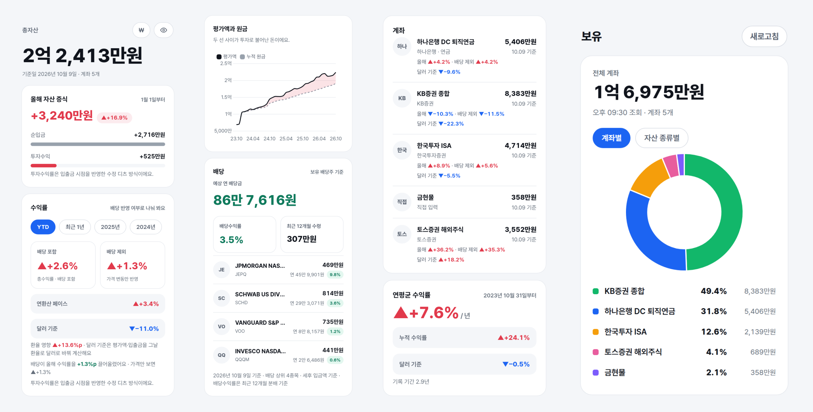

# 개미장부 (gaemi)

여러 증권 계좌와 퇴직연금, 예금·금까지 한 장부에 모아 **총자산이 얼마나, 왜 불었는지** 보여 주는 개인용 자산 앱입니다. 한국투자증권·토스증권 Open API로 매일 알아서 갱신되고, 폰에서는 홈 화면 앱처럼 열립니다. 서버 비용은 0원입니다.



<sub>화면은 모두 데모 데이터입니다.</sub>

> **English summary.** 개미장부 ("ant's ledger"; Korean retail investors call themselves *gaemi*, ants) is a self-hosted portfolio tracker for Korean brokerage accounts. It pulls balances from the KIS (Korea Investment & Securities) and Toss Securities Open APIs, infers deposits and withdrawals from daily cash changes, computes money-weighted returns (Modified Dietz) with and without dividends and in USD terms, and serves a mobile web app. Your ledger and API keys stay on your own PC; an optional Cloudflare Worker (free plan) gives your phone a read copy behind Cloudflare Access. MIT licensed.

## 무엇을 보여 주나

- **총자산과 올해 자산 증식**: 늘어난 돈을 내가 넣은 돈(순입금)과 투자로 번 돈(투자수익)으로 나눠 보여 줍니다.
- **수익률 세 가지**: 기간(YTD, 최근 1년, 연도별)마다 **배당 포함**, **배당 제외**, **달러 기준**(환율 변동 제외) 수익률을 같이 봅니다. 입출금 시점을 반영하는 수정 디츠(Modified Dietz) 방식입니다.
- **배당**: 보유한 배당주만으로 계산한 배당수익률, 예상 연 배당금, 종목별 배당률, 월별 배당금.
- **보유 종목**: 증권사 API로 지금 잔고를 조회해 종목별 평가액과 손익(원화, 달러 기준)을 보여 주고, 원그래프를 계좌별 또는 자산 종류별(주식·채권·금·코인·현금)로 바꿔 볼 수 있습니다.
- **입출금 자동 추정**: 한투·토스는 입출금 내역 API가 없어서, 매일 기록한 현금 변화에서 매매대금과 배당을 빼서 입출금을 추정합니다.
- **알림 배너**: 동기화가 실패하면 원인과 해결 방법을 화면 위에 보여 줍니다(예: 토스 허용 IP 미등록).
- **편의 기능**: 금액 숨기기, ₩/$ 전환, 밝은 테마, 폰에서 화면 녹화·사진 올리기.

## 지원하는 계좌

| 계좌 | 방식 | 상태 |
|---|---|---|
| 한국투자증권 | Open API: 잔고, 체결, 배당(주당 배당 × 보유수량), 입출금은 현금 변화로 추정 | 실계좌로 검증 |
| 토스증권 | Open API: 잔고, 체결, 배당은 한투 API의 주당 배당으로 계산, 입출금 추정 | 실계좌로 검증 (허용 IP 등록 필요, 배당 계산에 한투 키 필요) |
| KB증권 | Open API (종합위탁) | **실험적**: 실계좌로 시험해 보지 않았습니다 |
| DC 퇴직연금 (API 없음) | ETF 한 종목을 매달 부담금으로 사는 규칙으로 모델링, 한투 종가로 평가 | 선택 기능 (`DC_*` 설정) |
| 예금·적금 | 납입원금만 셈. 잔액을 가끔 입력하면 늘어난 만큼을 입금으로 기록 | 선택 기능 (`ASSETLOG_PRINCIPAL_ONLY`) |
| 금현물 | 보유 g × KRX 금 시세(한투 API) | 선택 기능 (`ASSETLOG_GOLD_ACCOUNT`) |
| 그 밖의 계좌 | 평가액 직접 입력, 한투 엑셀·토스 거래내역서 PDF·일반 CSV 가져오기 | |

## 어떻게 동작하나

```
 증권사 Open API ──▶  내 PC (장부 SQLite + API 키)  ──15분마다──▶  Cloudflare Worker (무료)  ◀── 폰 (홈 화면 앱)
                     매일 23:50 동기화                 화면 데이터만 올림        Cloudflare Access 로그인
```

- **장부와 API 키는 내 PC에만 있습니다.** 키는 `.env`(권한 600)에만 두고, Cloudflare에도 폰에도 올라가지 않습니다.
- PC가 매일 23:50에 증권사를 동기화하고, 15분마다 화면에 필요한 데이터만 Cloudflare Worker에 올립니다.
- 폰은 그 Worker를 엽니다. Cloudflare Access가 내 Cloudflare 계정으로 로그인한 사람만 들여보냅니다.
- 폰에서 넣은 값(평가액, 분류 변경, 파일)은 Worker에 쌓였다가 PC가 가져가 반영합니다.
- PC가 꺼져 있어도 폰에서 마지막 데이터는 볼 수 있습니다. 새 동기화는 PC가 켜질 때 됩니다.
- 앱은 **조회만** 합니다. 주문이나 출금 API는 부르지 않습니다.

## 빠르게 맛보기 (데모)

```bash
pip install -r requirements.txt
python3 -m assetlog demo                              # 데모 장부 data/demo.db 생성
ASSETLOG_DB=data/demo.db python3 -m assetlog serve    # http://127.0.0.1:8000
```

## 설치

AI 코딩 도구(Claude Code, Codex, Cursor 등)를 쓰신다면 이 저장소에서 **"개미장부 셋업해 줘"** 라고 하면 됩니다. Claude Code는 `.claude/skills/gaemi-setup/`, 다른 도구는 `AGENTS.md`를 읽고 아래 순서를 같이 진행합니다. API 키는 채팅에 붙여 넣지 말고 `.env`에 직접 넣으세요.

직접 하실 때의 순서입니다.

1. **준비**: Linux(systemd), Python 3.10 이상, (폰에서 쓰려면) Node.js 18 이상. 토스 PDF를 가져오려면 `pdftotext`(poppler)가 필요합니다.
   ```bash
   pip install -r requirements.txt
   cp .env.example .env && chmod 600 .env
   ```
2. **API 키 발급** 후 `.env`에 넣기
   - **한국투자증권**: [KIS Developers](https://apiportal.koreainvestment.com)에서 신청합니다. `KIS_CANO`는 종합계좌번호 앞 8자리, `KIS_ACNT_PRDT_CD`는 상품코드(위탁 `01`)입니다. 이용 기간이 1년이라 매년 연장해야 합니다. 토큰을 발급할 때마다 카카오톡 알림이 오는데, 하루 한 번은 정상입니다.
   - **토스증권**: 토스증권 PC 웹(WTS)의 `설정 > Open API`에서 발급하고, **이 PC의 공인 IP를 허용 IP로 등록**해야 합니다. 등록하지 않은 네트워크에서는 토스만 실패하고, 화면에 알림이 뜹니다.
   - **KB증권(실험적)**: KB증권 홈페이지 `고객서비스 > Open API`에서 신청합니다.
3. **확인**: `python3 -m assetlog probe kis` (또는 `toss`)로 API 응답을 확인하고, `python3 -m assetlog sync`로 첫 동기화를 합니다.
4. **화면 보기**: `python3 -m assetlog serve` 후 `http://127.0.0.1:8000`. 이 PC에서만 열리고 로그인은 없습니다.
5. **기준값 입력**: `입력` 탭에서 각 계좌의 지난해 말 평가액을 넣어야 올해 수익률이 나옵니다. 잔고증명서(토스 앱 증명서 발급, 한투 홈페이지)에서 확인할 수 있습니다.
6. **매일 자동 동기화**: `deploy/install.sh`가 매일 23:50 동기화 타이머를 설치합니다. 로그인하지 않아도 돌게 하려면 `sudo loginctl enable-linger $USER`를 한 번 실행하세요.
   ```bash
   ./deploy/install.sh
   ```

### 선택 기능

- **DC 퇴직연금 모델**: API가 없는 DC 계좌가 ETF 한 종목을 매달 부담금으로 산다면, `.env`의 `DC_ACCOUNT`, `DC_SYMBOL`, `DC_START`(주식 수를 정확히 아는 날짜, 그날 주식 수, 그날 현금)로 켭니다. 부담금이 들어오는 날(`DC_DAY`, 기본 25일, 휴일이면 직전 영업일)과 매수까지의 거래일 수(`DC_BUY_LAG`, 기본 5)는 회사 규칙에 맞게 바꾸세요. 가끔 은행 앱의 적립금 총액을 평가액으로 넣으면 그 값에 맞춰 다시 계산합니다.
- **예금·적금**: `입력` 탭에서 계좌를 만들고(기관 `manual`) 그 id를 `ASSETLOG_PRINCIPAL_ONLY`에 넣습니다. 이후 앱에 보이는 납입원금 합계를 가끔 평가액으로 넣으면 됩니다.
- **금현물**: 계좌를 만들고 id를 `ASSETLOG_GOLD_ACCOUNT`에 넣은 뒤, `입력 > 금현물 보유 입력`에 보유 g과 매입금액 합계를 넣습니다. 시세는 매일 한투 API로 받습니다(한투 키 필요).
- **자산 종류 분류**: 목록에 없는 종목은 주식으로 셉니다. 채권·금·코인 ETF는 `assetlog/classes.py`의 `CLASS`에 한 줄 추가하세요.

## 폰에서 쓰기 (Cloudflare 무료 플랜)

Cloudflare 계정만 있으면 됩니다. 결제는 필요 없지만, Zero Trust를 처음 켤 때 무료 플랜도 카드 등록을 요구할 수 있습니다(청구는 되지 않습니다). 아래 명령은 `cloud/`에서 실행합니다.

1. **준비**: `npm install && npx wrangler login`, 그리고 `cp wrangler.toml.example wrangler.toml`.
2. **D1 만들기**: `npx wrangler d1 create assetlog`가 출력하는 `database_id`를 `wrangler.toml`에 넣고, `npx wrangler d1 execute assetlog --remote --file schema.sql`로 테이블을 만듭니다. 인증 오류(`code: 10000`)가 나면 `--file schema.sql` 대신 `--command "$(cat schema.sql)"`를 쓰세요.
3. **PC 키**: `python3 -c 'import secrets; print(secrets.token_urlsafe(32))'`로 만든 값을 `npx wrangler secret put PC_KEY`와 `.env`의 `CLOUD_PC_KEY=`에 같이 넣습니다.
4. **배포**: `npx wrangler deploy`. 출력되는 `https://assetlog.<내 서브도메인>.workers.dev`를 `.env`의 `CLOUD_URL=`에 넣습니다. 이 단계에서는 Access 설정 전이라 모든 요청이 503으로 막혀 있는 게 정상입니다.
5. **Access 켜기**: 대시보드에서 이 Worker를 열고 `Access` 탭의 `Protect this Worker behind Access`를 누릅니다. 범위는 All traffic, 정책은 `Cloudflare account`(내 계정 멤버만), 세션은 1 month. **`Protect all Workers`는 누르지 마세요.** 계정의 다른 Worker까지 막힙니다. Email domain 정책도 쓰지 마세요(예: gmail.com을 넣으면 모든 Gmail 사용자가 들어옵니다).
6. **PC용 서비스 토큰**: Zero Trust > Access controls > Service credentials > Service Tokens에서 토큰을 만들고, 화면의 `CF-Access-Client-Id: <값>`에서 **값만** `.env`의 `CF_ACCESS_CLIENT_ID=`, `CF_ACCESS_CLIENT_SECRET=`에 넣습니다. Secret은 한 번만 보입니다.
7. **토큰 허용**: 이 Worker의 Access 애플리케이션(Zero Trust > Access controls > Applications)에 정책을 하나 더 추가합니다. Action은 `Service Auth`, Include는 위 서비스 토큰.
8. **Access 값 넣기**: `wrangler.toml`의 `ACCESS_TEAM`과 `ACCESS_AUD`를 채웁니다. 서비스 토큰을 넣은 뒤 `CLOUD_URL`로 요청을 보내면 받는 `CF_Authorization` 쿠키(JWT)의 `iss`가 `https://<팀>.cloudflareaccess.com`, `aud`가 AUD 태그입니다. 다시 `npx wrangler deploy`.
9. **연결 확인**: 프로젝트 폴더에서 `python3 -m assetlog cloud`가 성공하면 `./deploy/install.sh`를 다시 실행해 15분 타이머를 켭니다.
10. **폰**: `CLOUD_URL`을 열고 Cloudflare 계정으로 로그인한 뒤 `홈 화면에 추가`. 로그인은 한 달 유지됩니다.

`cloud/`나 `assetlog/static/`을 고쳤다면 `npx wrangler deploy`로 다시 배포합니다. 무료 플랜 기준 사용량은 하루 요청·읽기·쓰기 모두 한도의 1% 안팎입니다.

**걷어내기**: `systemctl --user disable --now assetlog-cloud.timer`, `.env`의 `CLOUD_URL=` 비우기, `cloud/`에서 `npx wrangler delete`와 `npx wrangler d1 delete assetlog`, 마지막으로 Zero Trust에서 Access 애플리케이션과 서비스 토큰 삭제.

## 계산 방식

- **자산 증가** = 기말 평가액 − 기초 평가액(넣은 돈 포함). **투자수익** = 자산 증가 − 순입금. 내 계좌끼리 옮긴 돈은 합계에서 저절로 상쇄됩니다.
- **투자수익률**: 수정 디츠. 배당은 계좌 평가액 안에 남으므로 이 값이 배당 포함(`return`)이고, 배당을 뺀 것이 `return_ex_div`, 배당이 보탠 몫이 `dividend_return`입니다(배당 포함 = 배당 제외 + 배당 기여).
- **보유 배당주 배당수익률**: 지금 가진 종목 중 배당을 준 종목만 모아, 최근 12개월 주당 배당(세후) × 보유 수량 ÷ 그 종목들의 평가액(`assetlog/payers.py`).
- **달러 기준 수익률**: 평가액·입출금·배당을 그날 환율로 달러로 바꿔 같은 계산을 한 값과, 원화 수익률과의 차이(환율 영향). 근거와 한계는 [`docs/fx-usd-return.md`](docs/fx-usd-return.md).
- **새 계좌**: 기록을 시작한 날의 평가액은 수익이 아니라 원금 투입으로 봅니다.

## 보안

- API 키는 `.env`(권한 600)에만 둡니다. `.env`, `data/`(장부·토큰), `inbox/`, `cloud/wrangler.toml`은 `.gitignore`에 들어 있습니다.
- 증권사 Open API 키가 있으면 **주문**이 가능합니다(출금·이체는 불가). 키가 새어 나갔다고 의심되면 증권사 사이트에서 바로 재발급하세요. 토스는 허용 IP가 있어 위험이 작고, 한투는 IP 제한이 없습니다.
- AI 도구에 키를 보여 주지 마세요. 작업 폴더를 통째로 비교·복사하는 명령은 `.env`와 `data/`를 빼고 실행해야 합니다.
- 로컬 서버는 `127.0.0.1`에서만 열리고, 인터넷 주소에서 온 요청과 다른 사이트에서 보낸 쓰기 요청을 거절합니다.

## 명령어

```bash
python3 -m assetlog serve          # 화면 (http://127.0.0.1:8000)
python3 -m assetlog sync           # 증권사 동기화
python3 -m assetlog cloud          # Cloudflare Worker와 주고받기
python3 -m assetlog probe kis      # API 원본 응답 확인 (키·토큰은 가림)
python3 -m assetlog backfill-fx    # 과거 환율을 장부에서 채우기 (API 호출 없음)
python3 -m pytest -q               # 테스트 (cloud/ 에서는 npm test)
```

## 구조

| 파일 | 역할 |
|---|---|
| `assetlog/brokers/{kis,toss,kb}.py` | 증권사별 조회 전용 클라이언트 |
| `assetlog/sync.py` | 동기화 (증권사 하나가 실패해도 나머지는 계속) |
| `assetlog/infer.py` | 입출금 추정 (현금 변화 − 매매대금 − 배당) |
| `assetlog/metrics.py` | 증가율, 수정 디츠 수익률, 달러 기준 |
| `assetlog/payers.py`, `classes.py` | 보유 배당주 배당수익률, 자산 종류 분류 |
| `assetlog/dcmodel.py`, `principal.py`, `gold.py` | DC 퇴직연금 모델, 예금·적금, 금현물 |
| `assetlog/importers.py` | 한투 엑셀, 토스 PDF, CSV 가져오기 |
| `assetlog/web.py`, `static/` | JSON API와 단일 파일 화면 (PWA) |
| `assetlog/cloud.py`, `cloud/` | PC ↔ Cloudflare Worker 주고받기, Worker 코드 |
| `deploy/` | systemd 사용자 타이머와 설치 스크립트 |
| `docs/contracts/*.json` | 공식 자료로 확인한 API·파일 형식 메모 |

## 주의

- 투자 조언 도구가 아닙니다. 수치는 추정을 포함하니 중요한 결정 전에는 증권사 원본과 대조하세요.
- 증권사 API 정책이나 응답 형식이 바뀌면 동작이 멈출 수 있습니다. 화면의 동기화 실패 배너와 `journalctl --user -u assetlog-sync`를 확인하세요.

## 라이선스

[MIT](LICENSE)
